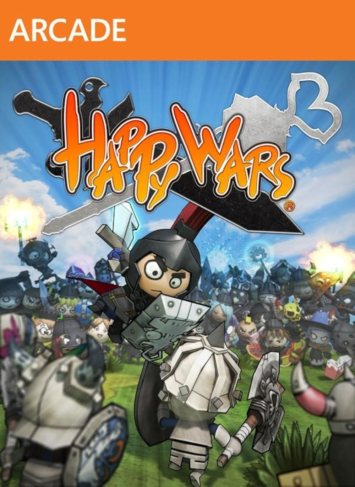

  

# Happy Wars Recompiled

An unofficial native Windows x64 port of the Xbox 360 version of Happy Wars, built through static PowerPC recompilation with ReXGlue.

The goal is offline Skirmish with the original bots, maps, equipment, Happy Cards and persistent progression. You must provide files from your own copy of the game.

**Work in progress:** the build renders the intro and 3D title screen. Local profile and storage services are under development. The mode menu and gameplay are not working yet.

[Latest prerelease](https://github.com/joojofc13-wq/HappyWarsRecompiled/releases/latest) · [Project status](STATUS.md) · [Build guide](docs/BUILDING.md)

## Table of Contents

- [Requirements](#requirements)
- [How to Run](#how-to-run)
- [Implemented Features](#implemented-features)
- [Roadmap](#roadmap)
- [Known Issues](#known-issues)
- [FAQ](#faq)
- [Building](#building)
- [Credits](#credits)

## Requirements

Development currently targets Windows x64 and a Direct3D 12 GPU supported by the pinned ReXGlue Xenos backend. Minimum hardware and performance requirements have not been measured.

Building requires Python, Git, Clang, MSVC headers and libraries, the Windows SDK, and your own Happy Wars Xbox 360 package. See the [tested toolchain](docs/TOOLCHAIN.md).

## How to Run

There is no ready-to-play installer yet. The prerelease contains source code and patches.

After following the [build guide](docs/BUILDING.md), double-click **LaunchHappyWars.cmd** in the project folder. It supplies the game, save and cache paths required by the executable.

Keyboard controls: Enter for Start, Space for A, Backspace for B, and WASD for the left stick. The SDK also supports controllers through SDL.

## Implemented Features

- Native Windows x64 executable from statically translated PowerPC code.
- Intro and 3D title rendering through the Xenos backend.
- Virtual local LIVE profile that passes the account check.
- In-process HTTP transport and SQLite storage with binary payload tests.
- Repeatable extraction, integrity checks, code generation and build scripts.

Storage tests pass, but complete in-game save loading remains unfinished.

## Roadmap

- [x] Extract and inspect the original game package.
- [x] Compile a native executable and render the title.
- [x] Pass the original account check with a local profile.
- [ ] Load or create valid player data and reach the mode menu.
- [ ] Start and complete Skirmish with the original bots.
- [ ] Preserve equipment, upgrades, rewards and Happy Cards between sessions.
- [ ] Validate available maps and modes.
- [ ] Measure and improve performance.
- [ ] Provide a builder for owners to compile their own copies.

## Known Issues

Startup is still unstable. The latest local-service build reaches storage reads and writes, then encounters a guest access violation. Crash before getting into the menu.

See [STATUS.md](STATUS.md) for validation and [save-service analysis](docs/SAVE_SERVICE_ANALYSIS.md) for the current investigation.

## FAQ

**Is this a Xenia launcher?**

No. The game CPU code is translated to C++ ahead of time and compiled for Windows x64. The port uses ReXGlue runtime components and its Xenos GPU backend.

**Does it require Xbox Live?**

The target is fully local play. The current code uses a synthetic profile and an in-process service, with no real account credentials.

**Are all maps and modes unlocked?**

Not yet. Resources and mode identifiers have been found, but their playable flows still need implementation and testing.

**Will I need my own game files?**

Yes. Original game files and translated game code are excluded from this repository. The cover above was supplied for the project page.

## Building

Follow [Building from Source](docs/BUILDING.md). Dependency revisions and hashes are pinned in `config/upstream-lock.json`.

Technical references: [executable analysis](docs/TECHNICAL_ANALYSIS.md), [native boot](docs/BOOT.md), [offline services](docs/OFFLINE.md), [function discovery](docs/FUNCTION_DISCOVERY.md), [account handling](docs/XENIA_NETPLAY.md) and [release policy](docs/RELEASES.md).

## Credits

- [ReXGlue](https://github.com/rexglue/rexglue-sdk) for the recompilation pipeline and runtime.
- [Xenia](https://github.com/xenia-project/xenia) and [Xenia Netplay](https://github.com/Nexia360/xenia-canary) for implementation references.
- [XenonRecomp](https://github.com/hedge-dev/XenonRecomp) for static recompilation references.
- [Extract-STFS](https://github.com/jasonulbright/Extract-STFS) for package extraction.
- [Unleashed Recompiled](https://github.com/hedge-dev/UnleashedRecomp) for project structure, presentation and release references.

Happy Wars belongs to its respective rights holders. Third-party notices are included with the relevant tools and patches.
